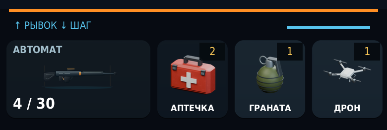

# Предметы по дизайну и читаемость забега — 28.11.2026

База снимков владельца и этого этапа: `e0c5421695b5f26f60e6d0d02c660b2a0292e14e`. Коммит игры и инструментов: `a0fa0a161d905348cc127958fc4f8398e23b3125`. Перед началом сверена `main`: `a24787217afc7ef72893e52d2fba753ca382c031`. Изменения продолжают [PR #3](https://github.com/EvgenyKonstantinov96/Games/pull/3); Issue #1 не закрыта. [Выход проверок](FIELD_KIT_CHECKS.txt).

На присланных владельцем кадрах видны открытый `[Debug Canvas]`, затемнение левой половины экрана, тёмные фигуры против заката, громила и прошедшие враги, перекрывающие героя, и небольшие линейные значки предметов. Это наблюдения по его копии игры, а не наш запуск PlayMode.

## Что изменилось

- **Отладочное перекрытие.** В исходниках Core 17.3 подтверждено имя `[Debug Canvas]`. При инициализации игра закрывает runtime/persistent панели через публичный `DebugManager` и отключает их сочетания клавиш. Редакторский Rendering Debugger отдельно не изменялся. В старой копии runtime UI переключается левым Ctrl + Backspace в Game View.
- **Читаемость моделей.** Усилен холодный заполняющий свет без дополнительной карты теней, уменьшены контраст, насыщенность и виньетка, немного увеличена экспозиция. Промышленная глава получила более нейтральные тени и менее красный основной свет. Общая броня имеет меньшую металличность и гладкость. Исходное значение `m_AdditionalLightsRenderingMode: 1` сохранено: в настоящем пакете это `PerPixel`.
- **Масштаб и перекрытия.** Масштаб Brute уменьшен с 1,55 до 1,22, высота точки прицеливания с 2,60 до 2,05 м. Его базовая модель остаётся крупнее обычного заражённого; размеры Boss не изменены. Прошедшие обычные враги возвращаются в пул за `z < -2,2` вместо `-8`, чтобы не проходить перед камерой крупным планом. Количество урона, условия контакта и сложность уровней не изменялись.
- **Аптечка.** Красный медицинский кейс со скруглёнными краями, ручкой, замками и встроенным белым крестом. Он заменяет старую форму и добавленные поверх неё примитивы креста в эффекте использования.
- **Граната.** Оливковый рифлёный корпус, металлическая горловина, рычаг и кольцо чеки. Используется существующая траектория броска, след и взрыв.
- **Дрон.** Светлый корпус, тонкие лучи, четыре мотора и отдельных вращающихся винта, посадочные опоры, вентиляция и камера. Перенесены огни и линза под новую геометрию; стабилизированная турель и логика сопровождения сохранены.
- **Материалы предметов.** Собственный общий атлас 512² с картами нормалей и metallic/smoothness, один кешируемый материал `ZSRCombatArt`. Предметы больше не используют раскраску дорожных ограждений.
- **HUD и улучшения.** Из настоящих новых OBJ отрендерены три прозрачных изображения 512². Внизу — карточка выбранного оружия с его принятым изображением и патронами, затем три кнопки 72×80 с крупным предметом и отдельным количеством. При работе дрона счётчик показывает секунды. Кнопки учитывают наличие зарядов, состояние забега и занятость руки; аптечка недоступна при полном здоровье. В меню улучшений используются те же изображения.
- **Сообщения урона.** Под сообщением есть тёмная плашка; текст контакта/кислоты светлый и непрозрачный. Число здоровья остаётся белым. Боковые сигналы направления урона сохранены.

Все девять FBX с предыдущего этапа и четыре принятых изображения оружия сохранены **побайтно**. Это этап предметных моделей, материалов, света и интерфейса; новая анатомия персонажей и симуляция ткани здесь не добавлялись. Сохранены 1000 уровней, первые 15, сохранения, сюжет, управление, оружие и экономика.

## Доступные проверки

| Проверка | Результат и граница доказательства |
| --- | --- |
| C# с настоящими библиотеками | PASS Roslyn: 27 runtime-исходников отдельно для Android и Editor, 18 editor-исходников. Unity 6000.3.28f1, UGUI 2.0.0, Input System 1.16.0, URP/Core 17.3.0; без заглушек пакетов. Это API-компиляция, без импорта Unity и исполнения сцен; предупреждения компилятора в этом проходе подавлены. |
| Модели предметов | PASS индексы, UV, единичные нормали, невырожденные грани, габариты и крепления роторов. Дрон 1084 треугольника, винт 100 (четыре — 400), граната 1220, аптечка 340. Полигоны декоративных runtime-огней и турели в эти числа не входят. |
| Изображения и импорт | PASS три различных RGBA 512², прозрачный край, минимум 12 пикселей поля, нет обрезания; палитра, отключённые mipmaps и NPOT scaling. Реальное сжатие ASTC и его качество на устройстве не проверены. |
| Интерфейс | PASS настоящий класс `ZSRInterface` с явными UI/scene stand-ins: 27 портретных раскладок, все 40 страниц кампании, уровень 1000, 92 страницы диалога; три изображения, размеры кнопок, по одному вызову каждого обработчика, недоступность при пустом запасе/полном здоровье, читаемая плашка урона. Это не uGUI-рендер и не сенсорное испытание телефона. |
| Граната | PASS 48 бросков при 20/30/60/120 Гц: выпуск, движущаяся дорога, смена темпа, пауза, след, отклонение точки взрыва менее 1 мм от расчёта. Настоящий класс полёта и Unity vector math; объекты сцены заменены stand-ins. |
| Контакт и кислота | PASS выделенные настоящие методы игры при 20/30/60/120 Гц: три типа ближней атаки, урон только в занятой полосе, пять сценариев плевка, уклонение, пауза, возврат прошедшего врага в пул, лимиты 6 снарядов/44 врага. Рендер, звук и Animator здесь не исполнялись. |
| Существующие ресурсы | PASS атлас, шрифты, меню, заголовки, четыре изображения оружия, мост и дорожные габариты. PASS 270 уникальных GUID, metadata всех файлов, сохранность девяти FBX. |
| Композиция | PASS 18 проекций Blender: два героя × три формата × три положения на трассе. Просмотрены новый кадр сцены и три отдельных предмета. Blender не воспроизводит URP. |
| Unity / Android | **BLOCKED**: новый batchmode Unity завершился до импорта с кодом 198, `No valid Unity Editor license found. Please activate your license.` Нельзя подтвердить Game View, PlayMode, APK, звук, FPS и расход памяти. |

SHA-256 последовательного содержимого отсортированных `Assets/Scripts/*.cs`, затем `Assets/Editor/*.cs`: `ce65a30af15ef57f15f5767dfa31edebf5f9260d71bac11901fe30be112c0e74`. HLSL на этом этапе не менялся; старые результаты отдельного компилятора шейдеров не записывались как новые запуски.

В самопроверке обнаружены вырожденные тонкие грани замков аптечки: скос ограничен толщиной детали, затем все предметы заново экспортированы, отрендерены и проверены. Пробник полёта первоначально не содержал новый класс материала — обновлена именно его заглушка; API-компиляция игры была успешна. Рендер иконок также исправлен: границы учитывают мировые координаты роторов и проекцию камеры, оставляя поле вокруг изображения.

## Изображения для просмотра

Ниже — **реконструкция раскладки интерфейса**, выполненная из JSON настоящего класса интерфейса и ресурсов игры. Это не скриншот Unity.



[Полная раскладка обычного HUD и сообщения о кислоте](../design/field-kit-hud-layout.jpg). [Кадр ресурсов сцены в Blender](../design/field-kit-run-blender.jpg) показывает Макса, новые предметы, уменьшенного громилу, свет промышленной главы, дорогу и ворота; это отдельный рендер для проверки композиции, без игрового UI.

## Повторение и приёмка

Из корня проекта, с Python/Pillow/NumPy и Blender 4.3.2:

```sh
python -B Tools/Art/build_combat_props.py
blender -b -t 2 --factory-startup --python-exit-code 1 -P Tools/Art/render_fieldkit.py -- --out Assets/Resources/UI
python -B Tools/Art/check_fieldkit.py --unity-data /path/to/Unity/Editor/Data
python -B Tools/QA/check_interface.py --unity-data /path/to/Unity/Editor/Data --output /tmp/zsr-kit-ui
python -B Tools/Art/preview_interface.py /tmp/zsr-kit-ui
python -B Tools/QA/check_flight.py --unity-data /path/to/Unity/Editor/Data
python -B Tools/QA/check_toxic.py --unity-data /path/to/Unity/Editor/Data
python -B Tools/Art/check_premium_assets.py
python -B Tools/Art/check_campaign_assets.py
blender -b -t 2 --factory-startup --python-exit-code 1 -P Tools/Art/preview_run_frame.py -- . /tmp/zsr-kit-run.png --chapter 1 --combat --max --contact-review
```

Для проверки настоящей игры: скачать текущую ветку PR, открыть в Unity 6000.3.28f1, дождаться импорта, **Zombie Survival Run 0.8 → 2 • Open Game → Play**. Проверить отсутствие `[Debug Canvas]`, меню «Предметы», все три кнопки во время забега и их эффекты, встречу с Brute и Boss, обе модели героя, ночную/промышленную/эвакуационную темы. Чистый кадр сохранить пунктом **5 • Save Game Screenshot**. Диагональные линии Gizmos в Simulator проверять отдельно с выключенным Gizmos; исправление отладочной панели не доказывает их исчезновение.

Нагрузку обновлённых предметов и света нужно измерить на Android. Тесты матрицы, требующие Unity/PlayMode/устройства, сохраняют `BLOCKED`; совпадение с художественным дизайном на 100% этим этапом не подтверждено.
